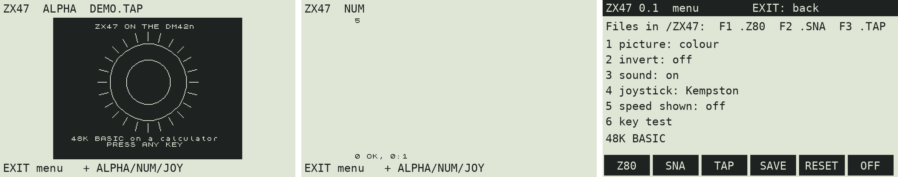

# ZX47 — a ZX Spectrum for the DM42n

**ZX47** is a 48K ZX Spectrum emulator as a native DMCP5 program (`.pg5`) for the SwissMicros **DM42n**, built like
[Chess 47](https://github.com/valdesvj/chess47.pg5), [NAV47](https://github.com/valdesvj/nav47.pg5) and
[GB47](https://github.com/valdesvj/GB47.pg5).



The Spectrum's 256×192 picture is shown 1:1 in the middle of the LCD. Only the lines that change go to the LCD:
FPS47 measured about 0.25 ms a line on the DM42n, so a sprite moving in a still room (Knight Lore, Head over Heels,
Gunfright) costs about 7 ms a frame and runs at the Spectrum's own 50 frames a second, even on battery. Games that
redraw the whole screen drop to about 13–19 frames a second.

**Version 0.2.** First runs on the DM42n (0.1): 100% speed on USB power (160 MHz), 57% on battery (80 MHz).
0.2 makes the Z80 about 1.5× faster (memory read directly, flags as bytes, parity folded: measured as Cortex-M33
code under QEMU), skips drawing when the screen memory was not written, and lets the next frame run while the LCD
takes the last lines.

## Install

1. Copy `release/ZX47.pg5` to the calculator's disk (keep `DM42-x.yy.pg5` there too, to go back).
2. Make a folder `ZX47` on the disk and put your games in it: `.Z80`, `.SNA` (48K snapshots) and `.TAP` (tapes).
   `release/ZX47DEMO.TAP` is a small BASIC demo to start with.
3. **SETUP → System → Run DMCP** (or RESET with F1 held), **Load program → ZX47.pg5**.

Needs DMCP5 3.57 or later (interface 3.17). The Spectrum boots to `© 1982 Sinclair Research Ltd`.

## Keys

The letters follow TERM47: **A…O on the top keys** (Σ+ = A … E = O) and **P…Z on the digit block**. A Spectrum keyword
is the key with its letter: P = PRINT, J = LOAD, R = RUN, L = LET …

| Key | All layers |
|---|---|
| ENTER | ENTER |
| R/S | SPACE |
| SHIFT | CAPS SHIFT (hold it with the other key) |
| `.` | SYMBOL SHIFT (hold it: `.` + P = `"`, `.` + K = `+` …) |
| ← | DELETE |
| ▲ ▼ | cursor up / down |
| `−` | BREAK |
| F1 F2 | cursor left / right |
| F3 F4 F5 F6 | EXTEND MODE, EDIT, GRAPHICS, CAPS LOCK |
| **`+`** | **the layer: ALPHA → NUM → JOY** (shown in the status line) |
| **EXIT** | **ZX47's menu** |

| Digit block | ALPHA | NUM | JOY |
|---|---|---|---|
| 7 8 9 ÷ | P Q R S | 7 8 9 `/` | ↖ ↑ ↗, S |
| 4 5 6 × | T U V W | 4 5 6 `*` | ← fire →, W |
| 1 2 3 | X Y Z | 1 2 3 | ↙ ↓ ↘ |
| 0 | 0 | 0 | fire |

**JOY** makes the digit block a joystick: Kempston (the default), cursor keys (5 6 7 8 0) or Sinclair
(6 7 8 9 0) — menu item 4. ▲ ▼ are up and down too, and the top keys stay letters. The calculator reads two keys at
once: enough for SHIFT + a key, or moving + fire. Many games let you choose their keys: pick calculator letters.

## The menu (EXIT)

| | |
|---|---|
| F1 Z80 · F2 SNA · F3 TAP | load a file from `/ZX47`. A tape is inserted, the Spectrum reset and `LOAD ""` typed for you: it loads at once (the ROM's tape routine is short-cut) |
| F4 SAVE | the Spectrum as it is now → `/ZX47/<name>-SAVE.SNA` (load it with F2 to go on later) |
| F5 RESET · F6 OFF | off keeps the Spectrum as it is: ON goes on where you were |
| 1 picture | **colour**: in each 8×8 cell the darker colour is black, the lighter white (light drawings on black stay so, as on a TV); **ink**: every set pixel black |
| 2 invert · 3 sound | sound: the beeper's tone each frame on the buzzer (rough, but it beeps) |
| 4 joystick · 5 speed | the status line shows the speed (100% = the real Spectrum) and the ms a frame spent running the Z80 (**z**) and drawing (**s**); a frame has 20 ms |
| 6 key test | shows the keys the calculator reports (for checking the keys on your DM42n) |

The settings are kept in `/ZX47/ZX47.CFG`.

## What works, what not yet

- 48K Spectrum, its ROM, `.Z80` (versions 1, 2, 3), `.SNA`, `.TAP` (standard loading: most games).
- Not yet: 128K games and the AY sound chip, `.TZX` tapes (turbo loaders, copy protection), memory contention
  and the floating bus (a few games need them), border effects.
- The beeper is approximated: one tone a frame on the buzzer.

## Where to find games

[Spectrum Computing](https://spectrumcomputing.co.uk/) keeps the archive. Each game shows whether its authors allow
it to be shared; many do, and lots of new homebrew games are free. Download the `.TAP` or `.Z80`, copy it to `/ZX47`.

## Build

Requirements: `arm-none-eabi-gcc` with newlib, `make`, `python3` (Pillow for the simulator pictures).

```bash
cd ~/opt/zx47.pg5
make              # -> build/ZX47.pg5
make test         # the Z80 core (prelim, zexdoc) and the machine (boot, keys, tape, .SNA, .Z80)
make bench        # how fast the machine runs on the PC (only the ratio between versions means something)
make shots        # the PC simulator's screens -> build/sim/run/*.png
make demo         # release/ZX47DEMO.TAP from test/demo.bas
```

The simulator runs the real program against a fake DMCP layer; its timings mean little: speed is measured on the
calculator.

## Files

| | |
|---|---|
| `src/main.c` | the loop, the status line, the menu, files |
| `src/zx.c` | the 48K machine: memory, ports, keyboard, interrupt, tape, snapshots |
| `src/screen.c` | the picture to the LCD: colour/ink, only the changed lines |
| `src/keys.c` | the calculator's keys as the Spectrum's keyboard and joystick |
| `third_party/z80/` | the Z80 core: [superzazu/z80](https://github.com/superzazu/z80) (MIT), 16-bit ports added |
| `roms/48.rom` | the Spectrum 48K ROM (Amstrad: see `roms/README.md`) |
| `tools/mktap.py`, `tools/sna2z80.py` | a BASIC listing as a `.TAP`; a `.SNA` as a `.Z80` |
| `test/` | the PC tests, the demo listing, the Z80 exercisers, the simulator |
| `dmcp/`, `stm32_program.ld` | the SwissMicros DMCP5 SDK (BSD-3) |

## License

GPL-3.0-or-later (see `LICENSE` and `NOTICE`). The Z80 core is MIT (`third_party/z80/LICENSE`), the DMCP5 SDK BSD-3
(`LICENSE.DMCP5_SDK`), the ROM © Amstrad, distributed with their permission (`roms/README.md`).

This project was written with the help of AI; see [AI_ASSISTANCE.md](AI_ASSISTANCE.md).

SwissMicros and DM42 are trademarks of their owners. ZX Spectrum is a trademark of Sky. This project is not
affiliated with or endorsed by them, and comes with no commercial games.
