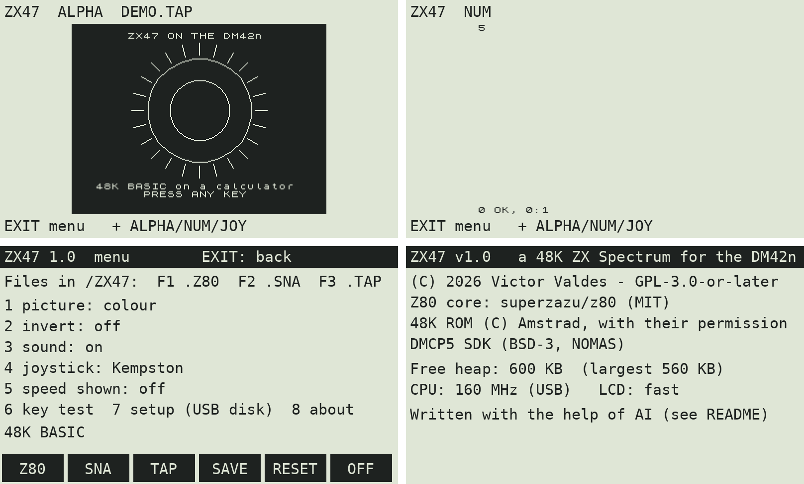
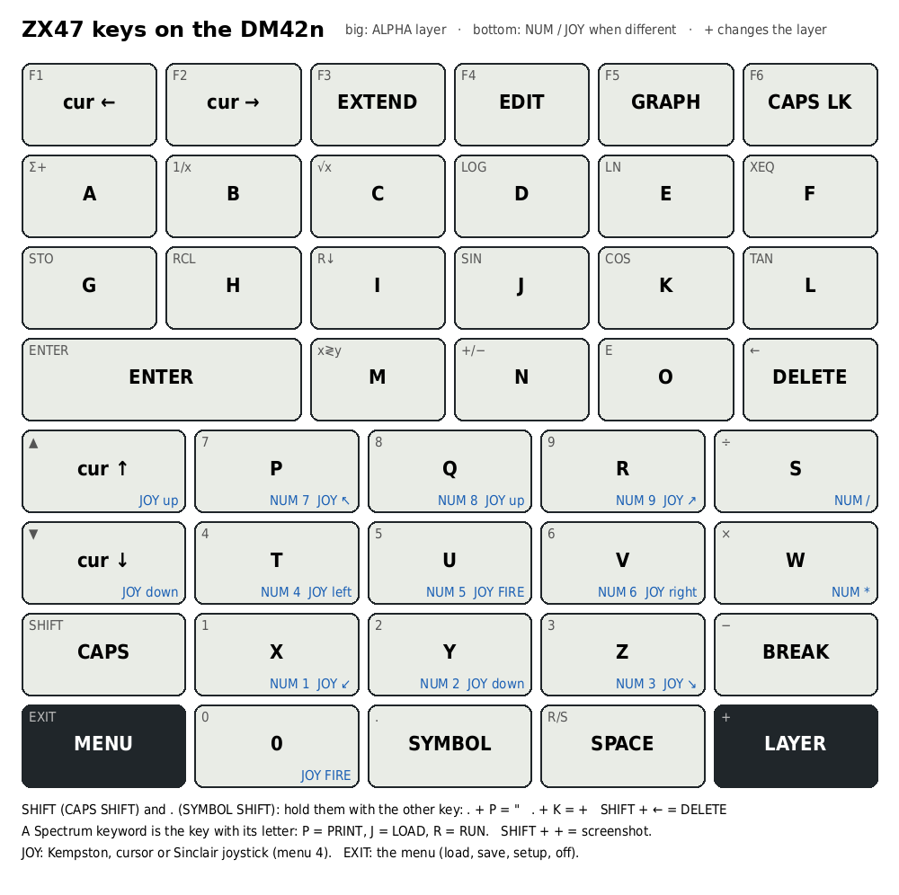

# ZX47 — a ZX Spectrum for the SwissMicros DM42n

**ZX47.pg5** is a stand-alone DMCP5 program written in C for the SwissMicros **DM42n**. It replaces the calculator
program (Free42) with a **48K ZX Spectrum**: Spectrum games and BASIC at the real machine's speed, on the
calculator's screen and keys, with the beeper's music on the buzzer.

Part of the "47" family of projects (almanac47, chess47.pg5, nav47.pg5, GB47 …).



**📖 [The manual](docs/MANUAL.md)** — install, keys, loading games, settings.

## Install on the DM42n

1. **Back up the calculator disk first** (connect USB, copy everything).
2. Copy `release/ZX47.pg5` to the root of the calculator's USB disk.
   Also keep the current `DM42-x.yy.pg5` from SwissMicros there, so you can go back.
3. Make a folder **`ZX47`** on the disk and put your games in it: `.Z80`, `.SNA` (48K snapshots), `.TAP` (tapes).
   `release/ZX47DEMO.TAP` is a small BASIC demo.
4. Open the DMCP menu: **SETUP → System → Run DMCP**, or press **RESET while holding F1**.
5. Choose **Load program → ZX47.pg5**.

To return to Free42: in ZX47 press **EXIT → 7 setup → System**, or use **RESET+F1**, then
**Load program → DM42-x.yy.pg5**. Needs DMCP5 3.57 or later.

> DMCP5 holds one program at a time, so loading ZX47 replaces Free42 until you load the DM42 program again. Your
> state files on the disk are not touched.

## Keys



| Key | Action |
|---|---|
| **Σ+ … E**, digit block | the letters A…O and P…Z (as TERM47): a Spectrum keyword is the key with its letter (P = PRINT, J = LOAD) |
| **+** | the layer: **ALPHA** (letters) → **NUM** (digits) → **JOY** (joystick on the digit block) |
| **SHIFT** · **.** | CAPS SHIFT · SYMBOL SHIFT (hold them with the other key: `.` + P = `"`) |
| **ENTER** · **R/S** · **←** · **−** | ENTER · SPACE · DELETE · BREAK |
| **▲ ▼ F1 F2** · **F3 F4 F5 F6** | the cursor · EXTEND MODE, EDIT, GRAPHICS, CAPS LOCK |
| **EXIT** | the menu: load, save, reset, off, settings, setup (USB disk, System), about |
| **SHIFT +** | a screenshot (a `.bmp` in `/SCREENS`) |

JOY is a Kempston, cursor or Sinclair joystick: **8 2 4 6** directions, **7 9 1 3** diagonals, **5 0** fire.
The calculator reads two keys at once: enough for moving + fire.

## The menu (EXIT)

| | |
|---|---|
| **F1 Z80 · F2 SNA · F3 TAP** | load from `/ZX47`. A tape: the Spectrum is reset, `LOAD ""` typed for you, and it loads at once |
| **F4 SAVE** | the game as it is → `/ZX47/<name>-SAVE.SNA` (F2 to go on later) |
| **F5 RESET · F6 OFF** | off keeps the game: ON goes on where you were |
| **1** picture · **2** invert | colour (the darker of each 8×8 square's two colours black) or ink (every set pixel black) |
| **3** sound · **4** joystick | the beeper on the buzzer · Kempston / cursor / Sinclair |
| **5** speed · **6** key test | the speed and the ms a frame (z running, s drawing) · the keys as numbers |
| **7** setup · **8** about | DMCP's setup (USB disk, System, time, date, beep) · version, licence, memory |

## Speed

The DM42n's LCD takes about 0.25 ms a line (measured with FPS47 in GB47), so ZX47 sends only the lines that
changed: a sprite moving in a still room (Knight Lore, Head over Heels) costs a few ms a frame. On USB power
(160 MHz) the Spectrum runs at full speed; on battery (80 MHz) busy games may run slower: **5 speed** shows it.

## What works, what not yet

- 48K Spectrum with its ROM, `.Z80` (versions 1, 2, 3), `.SNA`, `.TAP` (standard loading: most games), Kempston,
  cursor and Sinclair joysticks, the beeper (one tone a frame).
- Not yet: 128K games and the AY sound chip, `.TZX` tapes (turbo loaders, copy protection), memory contention and
  the floating bus (a few games need them), border effects.

Games: [Spectrum Computing](https://spectrumcomputing.co.uk/) shows for each game whether its authors allow it to
be shared. ZX47 comes with no commercial games.

## Build

Requirements: `arm-none-eabi-gcc` with newlib, `make`, `python3` (Pillow for the pictures).

```bash
cd ~/opt/zx47.pg5
make              # -> build/ZX47.pg5 (copy it to release/ for a release)
make test         # the Z80 core (prelim, zexdoc) and the 48K machine (boot, keys, tape, .SNA, .Z80)
make shots        # the PC simulator's screens -> build/sim/run/*.png
make bench        # the machine's speed on the PC (only the ratio between versions means something)
make demo         # release/ZX47DEMO.TAP from test/demo.bas
python3 tools/keymap.py docs/keymap.png    # the keys picture
```

## Inside

| | |
|---|---|
| `src/main.c` | the loop (50 frames a second), the status line, the menu, setup, about, files, screenshots |
| `src/zx.c` | the 48K machine: memory, ports, keyboard, interrupt, the tape (ROM trap), snapshots |
| `src/screen.c` | the picture to the LCD: colour / ink, only the changed lines |
| `src/keys.c` | the calculator's keys as the Spectrum's keyboard and joystick |
| `third_party/z80/` | the Z80 core: [superzazu/z80](https://github.com/superzazu/z80) (MIT), changed for the Spectrum and for speed |
| `roms/48.rom` | the Spectrum 48K ROM (Amstrad: `roms/README.md`) |
| `tools/` | `mktap.py` (a BASIC listing as a `.TAP`), `sna2z80.py`, `keymap.py`, `bin2c.py`, `pg5tool.py` |
| `test/` | the PC tests, the demo listing, the Z80 exercisers, the simulator |

## License

Written with the help of AI. See `AI_ASSISTANCE.md` for how it was used and checked.

GPL-3.0-or-later © 2026 Victor Valdes. `dmcp/` and `stm32_program.ld` are from the SwissMicros
DMCP5 SDK (BSD-3, released "NOMAS": not manufacturer supported). The Z80 core is MIT
(`third_party/z80/LICENSE`). The 48K ROM is © Amstrad, distributed with their permission
(`roms/README.md`). See `NOTICE`. Please don't contact SwissMicros about this program.

ZX Spectrum is a trademark of Sky. This project is not affiliated with or endorsed by Sky, Amstrad or SwissMicros.
