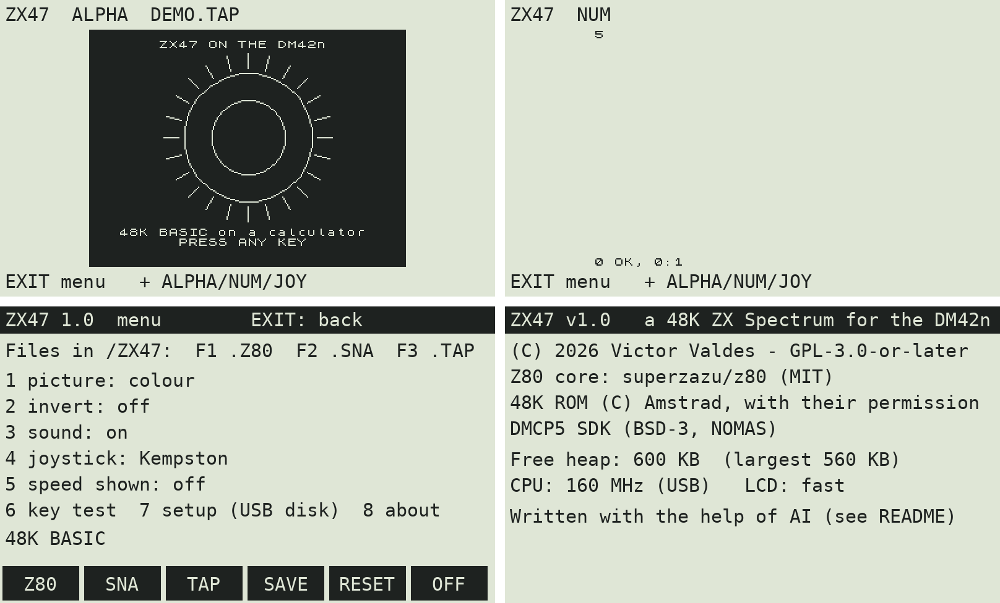
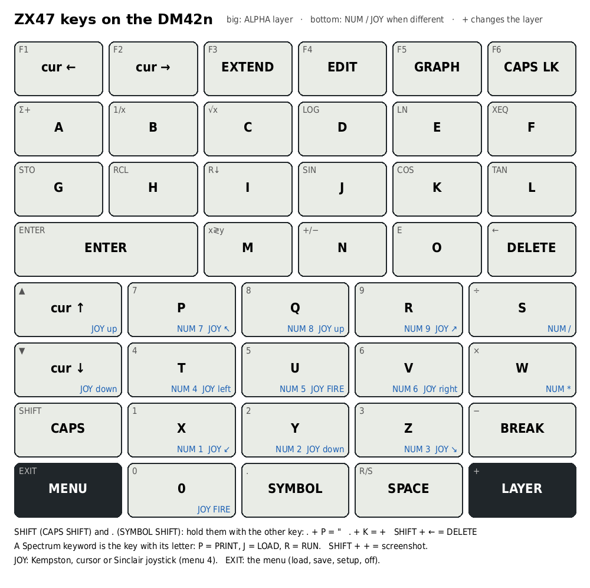

# ZX47 manual

ZX47 turns the SwissMicros **DM42n** into a **48K ZX Spectrum**. It runs Spectrum games and BASIC at the real
Spectrum's speed (on USB power; on battery the busiest games can run a little slower).



## 1. Install

1. **Back up the calculator's disk** (connect USB, copy everything).
2. Copy **`ZX47.pg5`** to the root of the disk. Keep SwissMicros' `DM42-x.yy.pg5` there too, to go back.
3. Make a folder **`ZX47`** on the disk. Put your games in it: **`.Z80`**, **`.SNA`** (snapshots) and **`.TAP`**
   (tapes). `ZX47DEMO.TAP` is a small demo to start with.
4. Open the DMCP menu: **SETUP → System → Run DMCP**, or press **RESET while holding F1**.
5. **Load program → ZX47.pg5**. The Spectrum starts: `© 1982 Sinclair Research Ltd`.

Needs DMCP5 3.57 or later.

## 2. The screen

```
 ZX47  ALPHA  KNIGHT.Z80          <- the key layer, the file (and the speed, if shown)
 +------------------------+
 |   the Spectrum screen  |       <- 256 x 192, as on the real machine
 +------------------------+
 EXIT menu   + ALPHA/NUM/JOY
```

## 3. Keys



- **Letters**: A…O on the top keys (Σ+ = A … E = O), P…Z on the digit block in the **ALPHA** layer. Spectrum
  keywords are typed with one key, the key with its letter: P = PRINT, J = LOAD, R = RUN, L = LET, G = GO TO.
- **`+` changes the layer**: **ALPHA** (letters) → **NUM** (digits) → **JOY** (joystick) → ALPHA. The top line
  shows the layer.
- **SHIFT** is CAPS SHIFT, **`.`** is SYMBOL SHIFT: hold them, then press the other key
  (`.` + P = `"`, `.` + K = `+`, `.` + Z = `:`).
- **ENTER** = ENTER, **R/S** = SPACE, **←** = DELETE, **−** = BREAK, **▲ ▼** and **F1 F2** = the cursor.
- **F3** EXTEND MODE, **F4** EDIT, **F5** GRAPHICS, **F6** CAPS LOCK.
- **JOY**: the digit block is a joystick, **8 2 4 6** up down left right, **7 9 1 3** diagonals, **5** and **0**
  fire. ▲ ▼ are up and down too. The joystick is Kempston, cursor keys or Sinclair: menu item 4. The top keys stay
  letters, so most games can be set to use them too.
- The calculator reads **two keys at once**: enough for SHIFT + a key, or moving + fire.
- **SHIFT + `+`**: a **screenshot**, saved as a `.bmp` in `/SCREENS`.

## 4. Loading a game

**EXIT** opens the menu:

| Key | |
|---|---|
| **F1** Z80 · **F2** SNA | load a snapshot from `/ZX47`: the game starts where the snapshot was taken |
| **F3** TAP | insert a tape: the Spectrum is reset and **`LOAD ""`** typed for you. The tape loads at once |
| **F4** SAVE | the game as it is now → `/ZX47/<name>-SAVE.SNA`; load it later with **F2** to go on |
| **F5** RESET | a fresh Spectrum |
| **F6** OFF | the calculator off. **ON** goes on where you were |

To load a tape by hand: **J** (LOAD), **`.` + P**, **`.` + P** (`""`), **ENTER**.

Many games ask for keys or a joystick at the start: choose **Kempston** and the **JOY** layer, or redefine the
keys to calculator letters.

## 5. Settings (in the menu)

| | |
|---|---|
| **1** picture | **colour**: in each 8×8 square the darker colour is black, the lighter white (as the game looks on a TV). **ink**: every drawn pixel black (try it when a game is hard to read) |
| **2** invert | black and white swapped |
| **3** sound | the Spectrum's beeper on the calculator's buzzer (a tone a frame: rough, but music plays) |
| **4** joystick | Kempston, cursor keys (5 6 7 8 0) or Sinclair (6 7 8 9 0) |
| **5** speed shown | the top line shows the speed (100% = the real Spectrum) and the ms a frame spent running (z) and drawing (s) |
| **6** key test | the key numbers the calculator reports (EXIT twice to end) |
| **7** setup | DMCP's setup: **USB disk** (copy games and screenshots), **System** (back to DMCP, to load the DM42 program), time, date, beep |
| **8** about | version, licence, free memory, CPU speed |

**EXIT** or **ENTER** goes back to the game. The settings are kept in `/ZX47/ZX47.CFG`.

## 6. Going back to the calculator

**EXIT → 7 setup → System**, then **Load program → DM42-x.yy.pg5**. (Or **RESET with F1 held**.)
Your games, saves and settings on the disk are not touched.

## 7. Good to know

- **48K games only** for now: 128K games, the AY music chip and `.TZX` tapes (turbo loaders, copy protection) are
  not there yet. A `.Z80` saved by a 48K Spectrum emulator works; a 128K one says so.
- **Battery**: the calculator runs at 80 MHz on battery and 160 MHz on USB power. Busy games may run slower on
  battery; the speed shown (menu 5) tells you.
- **Where to find games**: [Spectrum Computing](https://spectrumcomputing.co.uk/) shows for each game whether its
  authors allow it to be shared; many do, and many new homebrew games are free.

## 8. If something is wrong

| | |
|---|---|
| a key does nothing | menu **6 key test**: press it and see its number; the layer (top line) may be the wrong one |
| "128K: not yet" | the snapshot is of a 128K Spectrum: look for a 48K version of the game |
| the tape does not load | the game may use a turbo loader (`.TZX` only): look for a `.Z80` or another `.TAP` |
| the picture is hard to read | menu **1** (ink) or **2** (invert) |

---

ZX47 · © 2026 Victor Valdes · GPL-3.0-or-later · written with the help of AI (see `AI_ASSISTANCE.md`)
